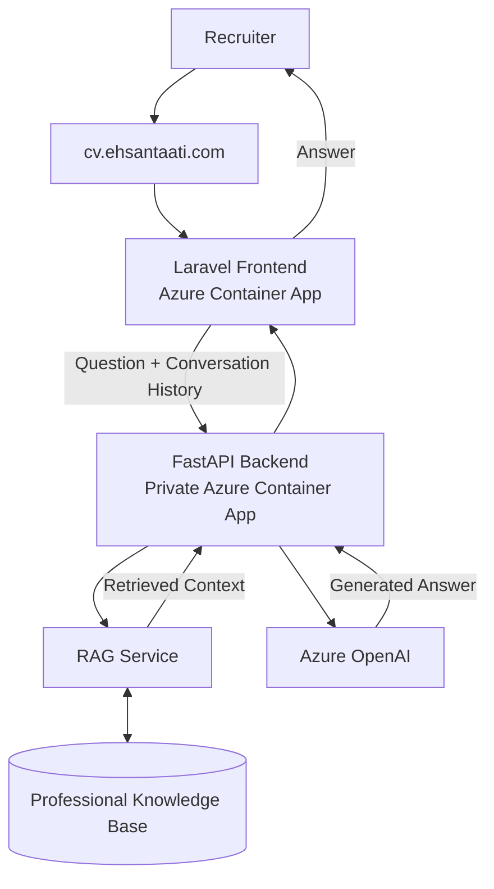

# Talking CV

An interactive AI-powered CV that lets recruiters explore my professional background through a conversational interface.

Talking CV combines a Laravel frontend with a FastAPI AI backend. The backend uses retrieval-augmented generation (RAG) so responses are grounded in a professional knowledge base covering my experience, technical skills, education, research, projects, and publications.

Conversation history is preserved during the session, allowing recruiters to ask natural follow-up questions and explore different parts of my background interactively.

## Live demo

🔗 **https://cv.ehsantaati.com**

Example questions:

- What is Ehsan's experience with AI?
- What are Ehsan's main technical skills?
- Tell me about Ehsan's recent projects.
- What experience does Ehsan have with speech AI?
- What research has Ehsan worked on?

## High-level architecture

## Roadmap

### V2.0 — Voice Interaction 🚧

Planned next steps:

- Microphone input
- Speech-to-text (STT)
- Voice questions with conversation history
- Text-to-speech (TTS)
- Synchronized text and audio responses
- Graceful fallback to text when voice services are unavailable
