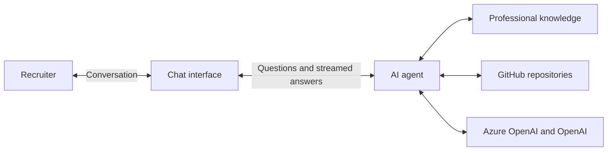
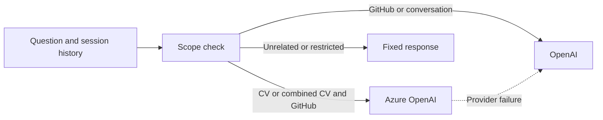
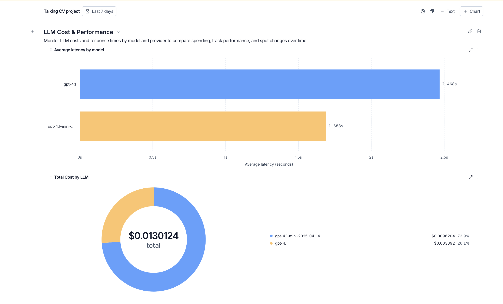
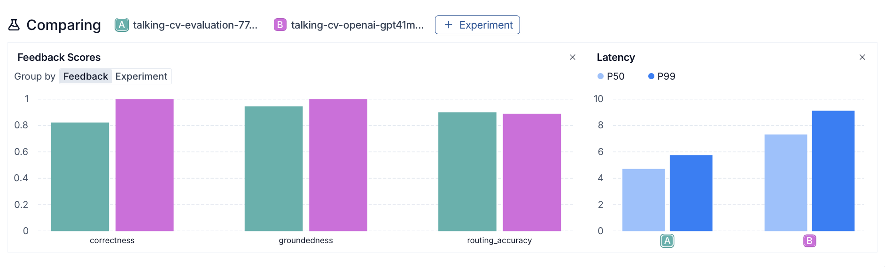

# Talking CV

An interactive AI-powered CV that lets recruiters explore my  academic and professional background through a conversational chat interface.

Built with Laravel, FastAPI, and LangGraph, the agent combines professional knowledge-base retrieval with GitHub tools exposed through the Model Context Protocol (MCP). It preserves session history for follow-up questions and streams its activity as it works.

**Deployed project:** https://cv.ehsantaati.com

## Engineering highlights

- **Intent-based model selection:** [routes questions to Azure OpenAI or OpenAI](docs/model-routing.md) through a shared LiteLLM gateway, with [provider fallback](docs/model-routing.md#provider-fallback).
- **Guardrail policies and grounded answers:** [layered scope, evidence, and tool-access checks](docs/guardrails.md) restrict requests to professional topics, validate claims against retrieved evidence, limit GitHub file reads to root READMEs, and return fixed fallbacks when validation fails.
- **Persistent retrieval:** [Qdrant stores document vectors and source metadata](docs/knowledge-base.md), with Azure OpenAI embeddings and a separate ingestion pipeline.
- **Bounded GitHub access:** [read-only MCP wrappers](docs/guardrails.md) support repository discovery and root README retrieval.
- **Visible agent activity:** the [streaming chat and live architecture chart](frontend/README.md#streaming-and-live-architecture) show tools, routes, and serving models.
- **Measured operation:** [LangSmith traces and dashboards](docs/observability.md) track model costs, latency, and provider fallbacks.

## High-level architecture



The agent selects relevant sources and models, checks supporting evidence, and streams its response. Explore the [detailed backend architecture](backend/README.md#detailed-architecture), [knowledge-base pipeline](docs/knowledge-base.md), and [GitHub access boundaries](docs/guardrails.md).

## Intent-based model routing



Scope and evidence checks use Azure as their primary provider and can fall back to OpenAI. See the [route mapping](docs/model-routing.md), [fallback policy](docs/model-routing.md#provider-fallback), and [validation flow](docs/guardrails.md) for details.

## LLM cost and performance

The LangSmith dashboard compares costs and response times by model and provider to track spending and spot performance changes.



See [dashboard configuration](docs/observability.md#cost-and-performance-dashboard) and [request trace correlation](docs/observability.md#matching-records-for-one-question).

## Evaluation

The [evaluation notebook](backend/notebooks/evaluation.ipynb) documents a 49-example benchmark covering CV facts, research, GitHub projects and policy boundaries. It compares answer correctness, groundedness, routing accuracy and response latency through LangSmith. The [dataset and scoring notes](backend/evaluation/README.md) describe the reference answers and expected behaviour labels.



*Example evaluation results. Correctness and groundedness use a 1–10 scale; routing accuracy is the proportion of correct routes. Higher is better for these scores. Latency is measured in seconds; lower is better. P50 is the median, and P99 is the time within which 99% of requests complete; tail estimates from a 10-question sample should be interpreted cautiously.*

This demo repository contains documentation, evaluation assets and notebook code. Running the notebook requires a separately running Talking CV backend and local credentials; application source code and environment files are not included.

## Run locally

Configure the [backend environment](backend/README.md#environment-variables) and [frontend environment](frontend/README.md#local-setup), then run:

```bash
docker compose up -d --build backend frontend
```

Open the chat at `http://localhost:8080`. Populate the [Qdrant knowledge base](docs/knowledge-base.md#qdrant-cloud-setup) before asking CV questions. See [Docker setup notes](docs/deployment.md#local-docker-compose) for networking and PDF mounts.

## Documentation

| Guide | Details |
| --- | --- |
| [Backend](backend/README.md) | Setup, environment variables, API, and tests |
| [Frontend](frontend/README.md) | Laravel setup, streaming UI, and live architecture |
| [Model routing](docs/model-routing.md) | Route mapping, model configuration, and fallback |
| [Guardrails](docs/guardrails.md) | Evidence checks, GitHub boundaries, and prompt versioning |
| [Knowledge base](docs/knowledge-base.md) | Qdrant, PDF ingestion, and document updates |
| [Observability](docs/observability.md) | LangSmith, trace correlation, cost, and latency |
| [Deployment](docs/deployment.md) | Docker, Azure configuration, and CI/CD |
| [Roadmap](docs/roadmap.md) | Delivered features and planned voice interaction |
