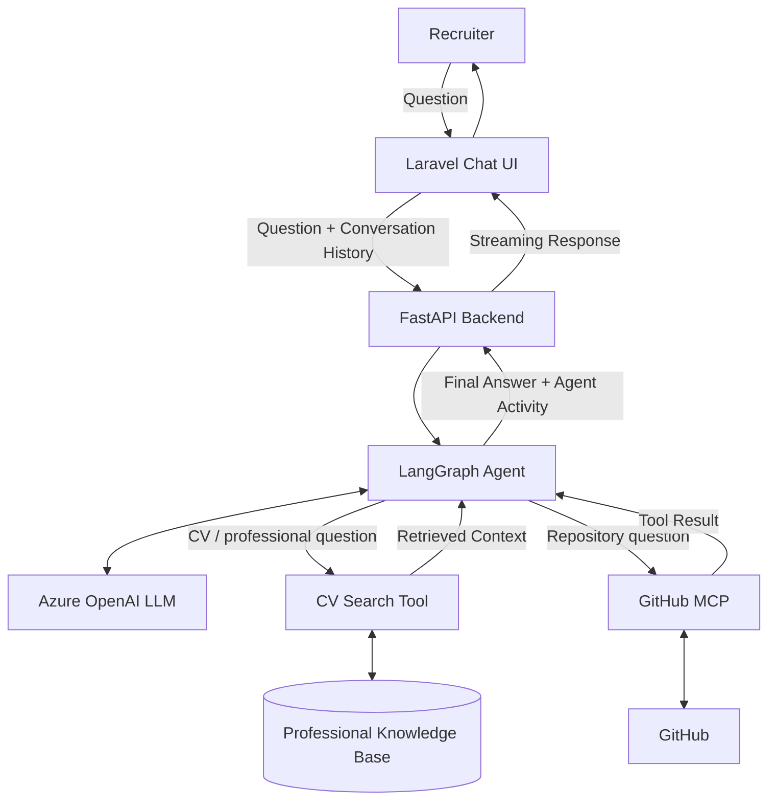
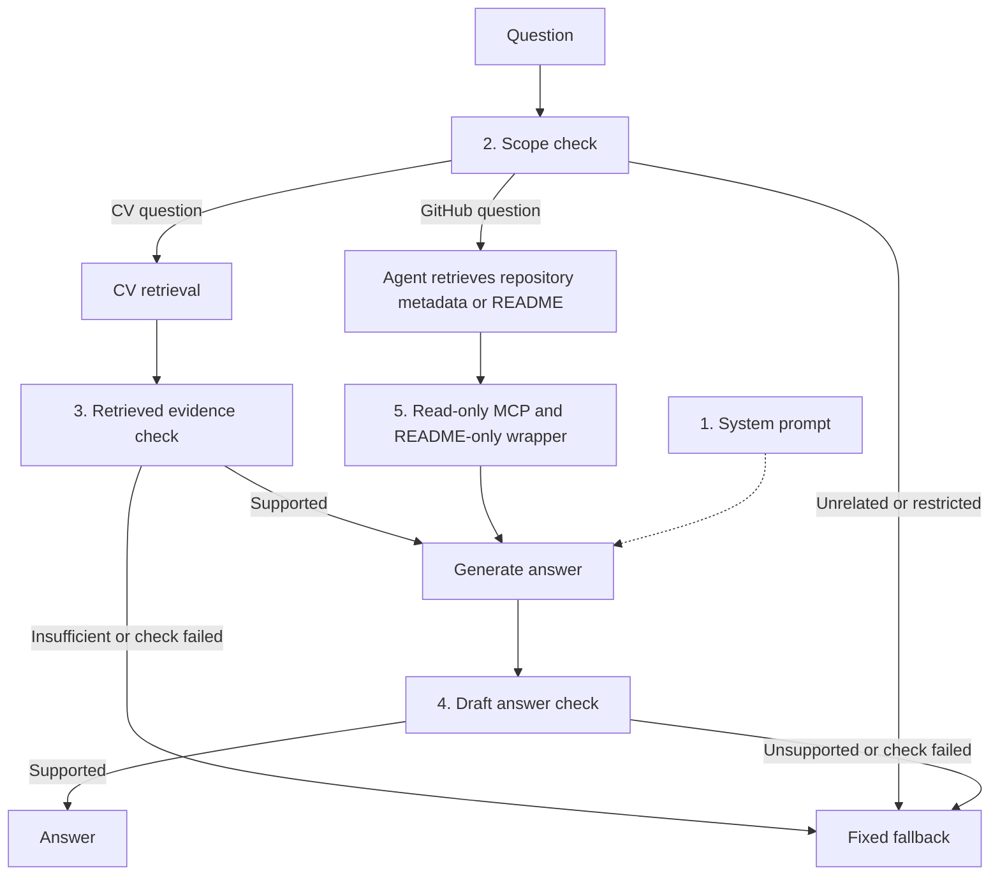

# Talking CV

[cv.ehsantaati.com](https://cv.ehsantaati.com)
---
An interactive AI-powered CV that lets recruiters explore my professional background through a conversational chat interface.

The application uses Laravel for the frontend and FastAPI as the AI backend. A LangGraph agent dynamically selects the appropriate tools based on each question, including retrieval from my professional knowledge base and external tools exposed through the Model Context Protocol (MCP).


Conversation history is preserved during the session, allowing recruiters to ask context-dependent follow-up questions naturally.

## High-level architecture



## RAG guardrails and GitHub access boundaries

Talking CV applies guardrails in five layers:

1. **System prompt:** defines the professional scope, allowed sources, and response rules.
2. **Before retrieval:** checks question scope, redirects unrelated or restricted requests, and removes unrelated parts of mixed requests.
3. **After CV retrieval:** checks whether the returned evidence supports the question before generating an answer.
4. **After generation:** checks the draft's factual claims against current tool evidence before showing the response to the user.
5. **Tool access control:** MCP is configured for read-only repository search and file retrieval; the agent sees only wrappers, with file reads fixed to the root `README.md`.

LangGraph enforces this flow and returns fixed fallback messages when checks fail. Scope and evidence judgments use the LLM, so they can make mistakes. Mixed requests receive a short explanation when an unrelated part is excluded.



GitHub access uses read-only MCP tools for repository discovery and root `README.md` retrieval. Python wrappers fix the file path, keeping other file contents inaccessible to the agent.

Implementation: [GitHub wrappers](backend/src/backend/mcp_tools/github.py) and [agent prompt and LangGraph checks](backend/src/backend/agent_service.py).

## Version roadmap

### V1.0 — Conversational RAG Chat ✅

Stable chat-based Talking CV with:

- Laravel chat interface
- FastAPI AI backend
- RAG-based retrieval from the professional knowledge base
- LLM-generated grounded responses
- Multi-turn conversation history
- Context-dependent follow-up questions
- Suggested starter questions
- New conversation / conversation reset
- Input validation
- Graceful FastAPI failure handling
- Laravel and FastAPI automated tests
- Docker-based deployment
- Azure Container Apps deployment
- GitHub Actions CI/CD

### V2.0 — Agentic Talking CV ✅

Extending the conversational system with agentic capabilities:

- LangGraph-based agent orchestration
- LLM-driven dynamic tool selection
- Professional knowledge-base retrieval exposed as an agent tool
- GitHub integration through MCP
- README-only GitHub file access enforced through wrapper tools, with repository discovery and explicit access-limit guidance
- Multi-tool execution and answer synthesis
- Real-time agent activity streaming through FastAPI and Laravel
- Recruiter-visible tool activity such as CV search and GitHub retrieval

### V3.0 — Voice Interaction 🚧

The next stage will extend the agentic conversational pipeline with voice support:

- Microphone input in the Laravel interface
- Speech-to-text (STT)
- Voice questions with conversation history
- Agentic tool selection through the existing LangGraph pipeline
- Text-to-speech (TTS)
- Synchronized text and audio responses
- Graceful fallback to text

```text
Recruiter
   │
   │ Speech
   ▼
Laravel UI
   │
   ▼
FastAPI
   │
   ├──► STT
   │       │
   │       ▼
   │   Transcribed Question
   │
   ▼
LangGraph Agent
   │
   ├──► CV / RAG Tool
   │
   ├──► MCP Tools
   │
   └──► LLM
           │
           ▼
      Final Response
           │
           ▼
          TTS
           │
           ▼
      Audio Response
           │
           ▼
      Laravel UI
       │       │
       ▼       ▼
      Text    Audio
           │
           ▼
       Recruiter
```

