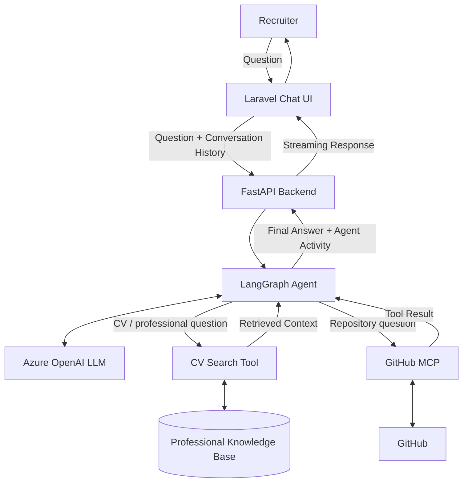

# Talking CV

An interactive AI-powered CV that lets recruiters explore my professional background through a conversational chat interface.

The application uses Laravel for the frontend and FastAPI as the AI backend. A LangGraph agent dynamically selects the appropriate tools based on each question, including retrieval from my professional knowledge base and external tools exposed through the Model Context Protocol (MCP).


Conversation history is preserved during the session, allowing recruiters to ask context-dependent follow-up questions naturally.

## High-level architecture



## Version roadmap

### V1.0 — Conversational RAG Chat ✅

Stable chat-based Talking CV with:

- Laravel chat interface
- FastAPI AI backend
- RAG-based retrieval from the professional knowledge base
- LLM-generated grounded responses
- Multi-turn conversation history
- Context-dependent follow-up questions
- Suggested starter questions
- New conversation / conversation reset
- Input validation
- Graceful FastAPI failure handling
- Laravel and FastAPI automated tests
- Docker-based deployment
- Azure Container Apps deployment
- GitHub Actions CI/CD

### V2.0 — Agentic Talking CV ✅

Extending the conversational system with agentic capabilities:

- LangGraph-based agent orchestration
- LLM-driven dynamic tool selection
- Professional knowledge-base retrieval exposed as an agent tool
- GitHub integration through MCP
- Multi-tool execution and answer synthesis
- Real-time agent activity streaming through FastAPI and Laravel
- Recruiter-visible tool activity such as CV search and GitHub retrieval

### V3.0 — Voice Interaction 🚧

The next stage will extend the agentic conversational pipeline with voice support:

- Microphone input in the Laravel interface
- Speech-to-text (STT)
- Voice questions with conversation history
- Agentic tool selection through the existing LangGraph pipeline
- Text-to-speech (TTS)
- Synchronized text and audio responses
- Graceful fallback to text

```text
Recruiter
   │
   │ Speech
   ▼
Laravel UI
   │
   ▼
FastAPI
   │
   ├──► STT
   │       │
   │       ▼
   │   Transcribed Question
   │
   ▼
LangGraph Agent
   │
   ├──► CV / RAG Tool
   │
   ├──► MCP Tools
   │
   └──► LLM
           │
           ▼
      Final Response
           │
           ▼
          TTS
           │
           ▼
      Audio Response
           │
           ▼
      Laravel UI
       │       │
       ▼       ▼
      Text    Audio
           │
           ▼
       Recruiter
```
