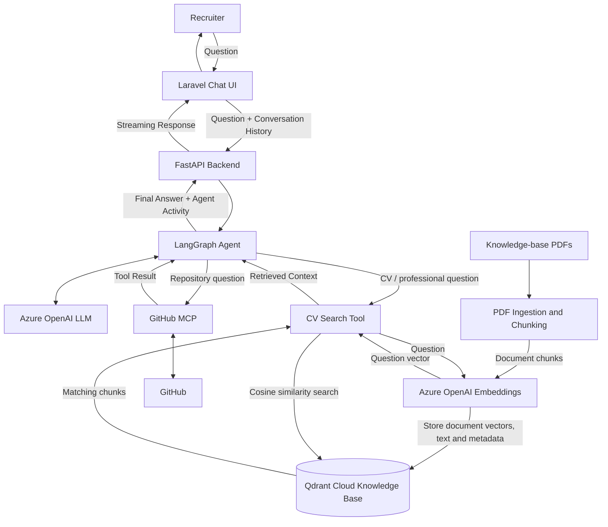
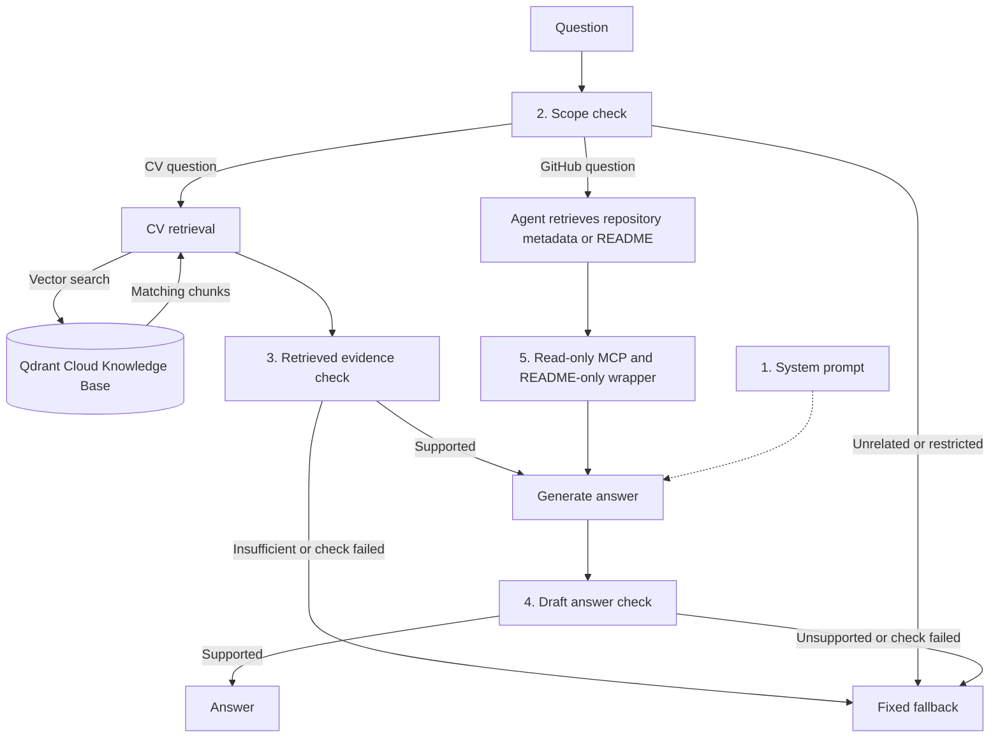

# Talking CV

[cv.ehsantaati.com](https://cv.ehsantaati.com)
---
An interactive AI-powered CV that lets recruiters explore my professional background through a conversational chat interface.

The application uses Laravel for the frontend and FastAPI as the AI backend. A LangGraph agent dynamically selects the appropriate tools based on each question, including retrieval from my professional knowledge base and external tools exposed through the Model Context Protocol (MCP).


Conversation history is preserved during the session, allowing recruiters to ask context-dependent follow-up questions naturally.

## High-level architecture



## Qdrant ingestion and retrieval

The backend searches the `cv` collection in Qdrant Cloud through LangChain's `QdrantVectorStore`, using an HTTPS cluster endpoint and a database API key. Cloud ingestion and retrieval from the local application have been verified; deploying this integration to Azure Container Apps is pending. A separate Docker Compose Qdrant service remains available for local development.

[Ingestion](backend/src/backend/ingest.py) loads PDF pages from the knowledge-base directory, splits their extracted text into chunks, generates Azure OpenAI embeddings, and stores vectors, chunk text, and metadata in Qdrant. Metadata includes source filename, document ID, document type (currently `document`), a SHA-256 document version, zero-based page number, start index in extracted page text, and a stable chunk UUID. These fields identify the source text; they do not contain PDF bounding boxes.

[Retrieval](backend/src/backend/retriever_service.py) connects to the existing collection and embeds each question to search for similar document vectors. It does not re-ingest PDFs or store questions in the knowledge base. Ingestion and retrieval use the same embedding deployment.

### Qdrant Cloud setup

Create a cluster in [Qdrant Cloud](https://cloud.qdrant.io/), copy its cluster endpoint, and create a database API key with write access for ingestion. See the [official quickstart](https://qdrant.tech/documentation/cloud-quickstart/). Keep the key in your untracked environment file; do not commit it.

Set these values in `backend/.env` alongside the existing Azure configuration:

```env
QDRANT_URL=https://your-cluster-endpoint:6333
QDRANT_COLLECTION=cv
QDRANT_API_KEY=your-database-api-key
KNOWLEDGE_PATH=/app/knowledge-base
```

From the project root, start the services and run ingestion before asking CV questions:

```bash
docker compose up -d --build backend frontend
docker compose exec backend uv run python -m backend.ingest
```

Inspect the collection and point payloads in the Qdrant Cloud console. After changing environment values, recreate the backend so it receives the new configuration:

```bash
docker compose up -d --build --force-recreate backend
```

### Updating the knowledge base

Add or update PDFs in `knowledge-base/`, then run:

```bash
docker compose exec backend uv run python -m backend.ingest
```

This writes to the endpoint configured in the running backend's `QDRANT_URL`. Stable IDs update existing points at the same document, page, and chunk offset, avoiding duplicates on unchanged re-ingestion. Removed or shifted chunks are not automatically cleaned up yet, and re-ingestion still generates document embeddings. Backend restarts reuse the stored collection without ingestion.

### Optional local Qdrant

To use the Docker database instead of Qdrant Cloud, set `QDRANT_URL=http://qdrant:6333` and `QDRANT_API_KEY=` in `backend/.env`, then run:

```bash
docker compose up -d qdrant
docker compose up -d --build --force-recreate backend
docker compose exec backend uv run python -m backend.ingest
```

Inspect local points at [the local dashboard](http://localhost:6333/dashboard). Local data persists in the `qdrant_data` named volume; deleting that volume deletes the local database. Cloud and local collections are separate and must each be populated. When using the cloud endpoint, the local service can be stopped with `docker compose stop qdrant`.

### Azure Container Apps configuration — pending

Before deploying the updated backend image, configure the `talking-cv-backend` Container App with:

| Environment variable | Value |
| --- | --- |
| `QDRANT_URL` | HTTPS Qdrant Cloud cluster endpoint |
| `QDRANT_COLLECTION` | `cv` |
| `QDRANT_API_KEY` | Secret reference to a Container Apps secret, such as `qdrant-api-key` |

In the Azure Portal, add the database API key under the app's **Secrets**, then set `QDRANT_API_KEY` to reference that secret in the container's environment variables. Keep the existing Azure OpenAI settings and use the same embedding deployment as ingestion. The deployed app's retrieval key can use read-only permissions for the collection; ingestion needs write access.

The cloud collection must be populated before deployment. Local ingestion into that same cloud collection updates the knowledge base used by the deployed app without rebuilding its image. Docker Compose services, the local volume, and `backend/.env` settings are not automatically provisioned in Azure by a backend image deployment. Build and push a new backend image tag, update the Container App's image and environment configuration, and verify a CV question after deployment.

## RAG guardrails and GitHub access boundaries

Talking CV applies guardrails in five layers:

1. **System prompt:** defines the professional scope, allowed sources, and response rules.
2. **Before retrieval:** checks question scope, redirects unrelated or restricted requests, and removes unrelated parts of mixed requests.
3. **After CV retrieval:** checks whether the returned evidence supports the question before generating an answer.
4. **After generation:** checks the draft's factual claims against current tool evidence before showing the response to the user.
5. **Tool access control:** MCP is configured for read-only repository search and file retrieval; the agent sees only wrappers, with file reads fixed to the root `README.md`.

LangGraph enforces this flow and returns fixed fallback messages when checks fail. Scope and evidence judgments use the LLM, so they can make mistakes. Mixed requests receive a short explanation when an unrelated part is excluded.



GitHub access uses read-only MCP tools for repository discovery and root `README.md` retrieval. Python wrappers fix the file path, keeping other file contents inaccessible to the agent.

Implementation: [GitHub wrappers](backend/src/backend/mcp_tools/github.py) and [agent prompt and LangGraph checks](backend/src/backend/agent_service.py).

### Prompt versioning

Prompts live in [backend/src/backend/prompts](backend/src/backend/prompts): `agent_system.txt`, `scope_check.txt`, `retrieval_check.txt`, `answer_check.txt`, and `rag_system.txt` for the older RAG answer path. Python loads them as package resources, so they work in local development and deployments. Git tracks their history alongside the code; separate numbered copies are unnecessary. Edit the relevant file, run the backend tests and your behaviour checks, then commit the change. Restart or redeploy the backend to apply prompt edits. LangSmith prompt hosting is not required.

## Version roadmap

### V1.0 — Conversational RAG Chat ✅

Stable chat-based Talking CV with:

- Laravel chat interface
- FastAPI AI backend
- RAG-based retrieval from the professional knowledge base
- LLM-generated grounded responses
- Multi-turn conversation history
- Context-dependent follow-up questions
- Suggested starter questions
- New conversation / conversation reset
- Input validation
- Graceful FastAPI failure handling
- Laravel and FastAPI automated tests
- Docker-based deployment
- Azure Container Apps deployment
- GitHub Actions CI/CD

### V2.0 — Agentic Talking CV ✅

Extending the conversational system with agentic capabilities:

- LangGraph-based agent orchestration
- LLM-driven dynamic tool selection
- Professional knowledge-base retrieval exposed as an agent tool
- GitHub integration through MCP
- README-only GitHub file access enforced through wrapper tools, with repository discovery and explicit access-limit guidance
- Multi-tool execution and answer synthesis
- Real-time agent activity streaming through FastAPI and Laravel
- Recruiter-visible tool activity such as CV search and GitHub retrieval

### Persistent vector retrieval ✅

- Qdrant Cloud storage with API-key authentication; optional Dockerised Qdrant with a persistent named volume
- Separate PDF ingestion command and query-time retrieval
- Azure OpenAI embeddings and cosine similarity search
- Source metadata, document version hashes, and stable chunk IDs
- Cloud ingestion and retrieval from the local application verified; Azure Container Apps deployment pending

### V3.0 — Voice Interaction 🚧

The next stage will extend the agentic conversational pipeline with voice support:

- Microphone input in the Laravel interface
- Speech-to-text (STT)
- Voice questions with conversation history
- Agentic tool selection through the existing LangGraph pipeline
- Text-to-speech (TTS)
- Synchronized text and audio responses
- Graceful fallback to text

```text
Recruiter
   │
   │ Speech
   ▼
Laravel UI
   │
   ▼
FastAPI
   │
   ├──► STT
   │       │
   │       ▼
   │   Transcribed Question
   │
   ▼
LangGraph Agent
   │
   ├──► CV / RAG Tool
   │
   ├──► MCP Tools
   │
   └──► LLM
           │
           ▼
      Final Response
           │
           ▼
          TTS
           │
           ▼
      Audio Response
           │
           ▼
      Laravel UI
       │       │
       ▼       ▼
      Text    Audio
           │
           ▼
       Recruiter
```
