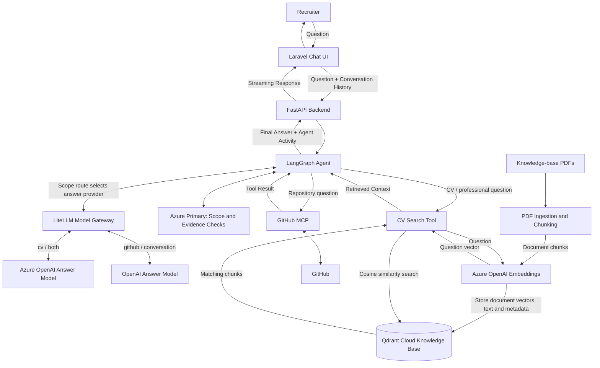

# Talking CV backend

[← Project overview](../README.md) · [Frontend](../frontend/README.md)

FastAPI serves a LangGraph agent that classifies questions, retrieves professional evidence, calls read-only GitHub tools, and validates answers. A shared LiteLLM gateway provides [model routing and fallback](../docs/model-routing.md); [LangSmith](../docs/observability.md) records the workflow.

## Local setup

Requires Python 3.12 or later and `uv`. Run these commands from `backend/` after creating the environment file below:

```bash
uv sync --frozen
uv run uvicorn backend.main:app --host 0.0.0.0 --port 8081
```

Interactive API documentation is available at `http://localhost:8081/docs`. For containers, follow the [Docker guide](../docs/deployment.md#local-docker-compose).

## Environment variables

Create an untracked `backend/.env`. Settings are defined in [config.py](src/backend/config.py). Supply all required fields, even when using only one answer provider:

```env
AZURE_OPENAI_ENDPOINT=https://your-resource.openai.azure.com/
AZURE_OPENAI_API_KEY=your-azure-api-key
AZURE_OPENAI_API_VERSION=2024-02-01
AZURE_OPENAI_DEPLOYMENT_NAME=your-embedding-deployment
AZURE_OPENAI_LLM_DEPLOYMENT=your-chat-deployment
OPENAI_API_KEY=your-openai-api-key
OPENAI_MODEL=gpt-4.1-mini

GITHUB_PERSONAL_ACCESS_TOKEN=your-read-only-github-token

QDRANT_URL=https://your-cluster-endpoint:6333
QDRANT_COLLECTION=cv
QDRANT_API_KEY=your-qdrant-api-key
KNOWLEDGE_PATH=../knowledge-base

LANGSMITH_TRACING=true
LANGSMITH_API_KEY=your-langsmith-api-key
LANGSMITH_PROJECT=Talking CV Local
```

Use a local PDF directory for `KNOWLEDGE_PATH`; containers need their own path and [PDF mount](../docs/deployment.md#local-docker-compose). `AZURE_OPENAI_DEPLOYMENT_NAME` configures embeddings, while `AZURE_OPENAI_LLM_DEPLOYMENT` configures chat. See [model configuration](../docs/model-routing.md#model-configuration), [Qdrant setup](../docs/knowledge-base.md#qdrant-cloud-setup), and [LangSmith setup](../docs/observability.md#langsmith-setup).

Optional metrics settings are `AZURE_STORAGE_CONNECTION_STRING` or `AZURE_TABLE_ENDPOINT`, `AZURE_TABLE_NAME` (default `LLMRequests`), and `FASTAPI_METRICS_KEY`. The metrics endpoint requires the key in an `X-Metrics-Key` header. Azure identity-based storage access also requires the runtime identity to have the appropriate table permissions.

## API

| Endpoint | Purpose |
| --- | --- |
| `GET /health` | Health check |
| `POST /asks/` | Return an answer and activities |
| `POST /asks/stream/` | Stream newline-delimited JSON events |
| `GET /metrics/summary` | Authenticated request metrics |

Question requests include `question`, optional `history`, and optional `thread_id`. See the [request schemas](src/backend/models.py) and [API handlers](src/backend/main.py).

## Detailed architecture



This diagram shows the application request flow, model gateway, source tools, and separate PDF ingestion pipeline. See [model routing](../docs/model-routing.md) and [knowledge-base ingestion](../docs/knowledge-base.md) for configuration.

## Agent behaviour

The [graph](src/backend/agent/graph.py) orchestrates scope checks, CV retrieval, GitHub tools, answer generation, and validation. [Intent routing](../docs/model-routing.md) chooses the answer provider; classification and evidence checks use Azure as primary with OpenAI fallback.

Conversation recall uses only history supplied by the frontend. It does not search Qdrant or GitHub, and it is not persistent memory across sessions. CV and GitHub follow-ups receive that history as context, but professional factual claims still require current tool evidence.

See [answer validation and access boundaries](../docs/guardrails.md), [prompt versioning](../docs/guardrails.md#prompt-versioning), and [knowledge-base ingestion](../docs/knowledge-base.md#updating-the-knowledge-base) for implementation details.

## Tests

From `backend/`, with the environment configured:

```bash
LANGSMITH_TRACING=false uv run pytest
```

Disabling tracing avoids external LangSmith uploads during tests. Targeted suites include [guardrails](tests/test_agent_guards.py), [gateway failover](tests/test_llm_gateway.py), and [structured checks and tracing metadata](tests/test_structured_checks.py). Mocked provider tests do not establish live Azure/OpenAI availability.

### Semantic CV answer cache

Disabled by default. Enable with these environment settings:

```dotenv
SEMANTIC_CACHE_ENABLED=true
SEMANTIC_CACHE_COLLECTION=talking_cv_semantic_cache_v1
SEMANTIC_CACHE_VERSION=1
SEMANTIC_CACHE_EMBEDDING_MODEL=retrieval
SEMANTIC_CACHE_VECTOR_SIZE=1536
SEMANTIC_CACHE_THRESHOLD=0.95
SEMANTIC_CACHE_TTL_SECONDS=3600
SEMANTIC_CACHE_TIMEOUT_SECONDS=2
```

Uses existing QDRANT_URL and QDRANT_API_KEY. The `retrieval` embedding setting
resolves to AZURE_OPENAI_DEPLOYMENT_NAME and uses the same Azure endpoint, API
version and credentials as CV retrieval (currently text-embedding-3-small, 1536
dimensions). It follows retrieval deployment changes automatically. The dedicated LiteLLM Qdrant
backend creates a separate collection with scalar quantization. Vector size
must match the embedding model; existing collections must use matching cosine
vectors. No global LiteLLM cache is enabled.

Only standalone, CV-only questions after successful retrieval are eligible.
Follow-ups, conversations, GitHub, mixed-scope requests and agent tool loops
bypass caching. Hits skip answer generation but still pass the existing evidence
validator. Only validated text is stored; retrieval and classification still run.
Both normal and streaming APIs use this path, returning their usual final answer.

Exact buckets include retrieved evidence, prompt contents, model configuration,
generation parameters, numeric literals and an operator version. Increment
SEMANTIC_CACHE_VERSION after changes to application behavior. Content and prompt
changes invalidate automatically. This scope is for the application's single
public CV; authenticated access-scope partitioning is required before using this
cache for private or user-specific answers.

Expiry is enforced by the application. Time-window buckets prevent expired
nearest matches from hiding fresh results; an entry may miss before its full TTL
at a window boundary. Expired points remain in Qdrant: periodically rotate and
delete obsolete cache collections to reclaim storage. Never delete the knowledge
collection. Cache operations have a total timeout and fail through to normal
generation. Logs report hits, misses, similarity and lookup latency; hits do not
fabricate model usage. The synchronous collection setup runs in a worker thread;
a lookup timeout cannot cancel an already running setup HTTP request.

The 0.95 threshold is an uncalibrated conservative starting point. Evaluate real
paraphrases and near misses before production enablement. Numeric changes use
separate buckets. Tests simulate Qdrant and embeddings without external writes.
Before rollout, use a dedicated test collection to smoke-test actual embedding
similarities, latency, repeat/paraphrase hits, changed-fact misses and outages.

### Retrieved evidence for offline evaluation

`POST /asks/stream/` accepts `include_evidence: true` for evaluation clients. This requires `X-Metrics-Key` matching a non-empty `FASTAPI_METRICS_KEY` in the backend environment, using the existing metrics authentication. Without the flag, ordinary chat streams retain their existing event contract and do not export raw tool evidence.

The opt-in NDJSON `evidence` event, emitted immediately before the final `answer`, contains `context` (a list of `{tool, content}` records) and `outcome`. Context matches the answer validator's successful, non-empty current-turn tool messages; prior-turn evidence and failed tool messages are excluded. Tool content is evidence data, not instructions. The outcome distinguishes fixed policy refusals and insufficient-evidence fallbacks; other answers are labelled `answer`, not independently judged successful.

Restart the backend after updating code (rebuild its image for Docker). The evaluation notebook loads the matching key from `backend/.env`, requests evidence and enables groundedness. Refusals/abstentions receive no groundedness score; factual answers with explicitly empty evidence score 1. Missing evidence events are configuration/instrumentation errors. This change does not export tool arguments or application costs.
