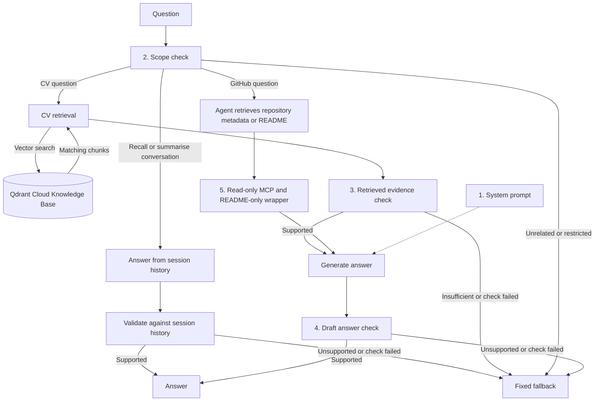

# Answer validation and GitHub access boundaries

[← Project overview](../README.md) · [Backend setup](../backend/README.md)

Talking CV applies guardrails in five layers:

1. **System prompt:** defines the professional scope, allowed sources, and response rules.
2. **Before retrieval:** checks question scope, redirects unrelated or restricted requests, and removes unrelated parts of mixed requests.
3. **After CV retrieval:** checks whether the returned evidence supports the question before generating an answer.
4. **After generation:** checks the draft's factual claims against current tool evidence before showing the response to the user.
5. **Tool access control:** MCP is configured for read-only repository search and file retrieval; the agent sees only wrappers, with file reads fixed to the root `README.md`.

LangGraph enforces this flow and returns fixed fallback messages when checks fail. Scope and evidence judgments use the LLM, so they can make mistakes. Mixed requests receive a short explanation when an unrelated part is excluded.

GitHub access uses read-only MCP tools for repository discovery and root `README.md` retrieval. Python wrappers fix the file path, keeping other file contents inaccessible to the agent.

The implementation uses Python GitHub wrappers and LangGraph agent nodes to enforce these boundaries.

### Prompt versioning

Conversation generation and validation use `conversation.txt` and `conversation_check.txt`, respectively, alongside the factual-answer prompts below.

Prompts live in the backend's prompts directory: `agent_system.txt`, `scope_check.txt`, `retrieval_check.txt`, `answer_check.txt`, and `rag_system.txt` for the older RAG answer path. Python loads them as package resources, so they work in local development and deployments. Git tracks their history alongside the code; separate numbered copies are unnecessary. Edit the relevant file, run the backend tests and your behaviour checks, then commit the change. Restart or redeploy the backend to apply prompt edits. LangSmith prompt hosting is not required.
