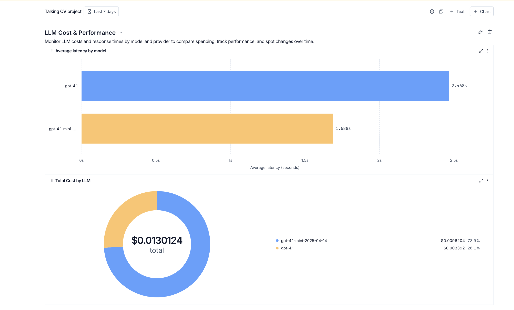

# Observability

[← Project overview](../README.md) · [Backend setup](../backend/README.md)

## Observing model selection

The frontend's Live Agent Architecture chart shows the classified route beneath Router and the selected provider/model beneath AI Agent or Conversation when an answer-model call starts. Labels reset for each question and remain empty while idle or when no answer model is invoked. Rebuild both services when applying changes to the chart and its backend stream:

```bash
docker compose up -d --build backend frontend
```

The backend streams `route` events after classification and `model` events on routed answer-model start/end. Model events include the node, route, provider, model, and run ID. Start events show the selected primary; end events identify the actual serving provider, so the chart updates after a successful fallback. LangSmith answer-model calls carry `scope_route`, `selected_provider`, and `selected_model` metadata for the primary selection. Response metadata includes `model_id` (`azure` or `openai`) for the actual deployment, distinguishing providers even when they use the same model family.

To exercise the OpenAI route, ask a GitHub-only question such as “List Ehsan's GitHub repositories.” A question classified as `both` will use Azure even though GitHub tools execute. Inspect recent model response metadata in the container logs with:

```bash
docker compose logs --since 5m -f backend | grep --line-buffered -E 'LLM initialized:|Response metadata:'
```

Gateway initialization messages appear only on first use of each provider in a backend process. Response metadata and per-call trace metadata provide evidence of subsequent invocations.

## LangSmith setup

When `LANGSMITH_TRACING=true`, the gateway registers LiteLLM's built-in `langsmith` callback for high-level success/failure logging. It uses the existing API key and sends its diagnostic records to the same project as the agent traces:

```env
LANGSMITH_TRACING=true
LANGSMITH_API_KEY=your-langsmith-api-key
LANGSMITH_PROJECT=Talking CV Local
```

Both detailed `agent_stream` conversation traces and LiteLLM `LLMRun` child records use `LANGSMITH_PROJECT` (`Talking CV Local` in this setup). They appear together in one project, with new LiteLLM records nested under the matching agent request; use the Runs view or expand the agent trace to inspect them. Existing records in other projects remain there. LiteLLM sends records in batches, so they may take a short time to appear. These records supplement the existing LangChain/LangGraph request traces. They are not custom per-attempt spans, are not guaranteed to cover every internal retry, and are nested beneath the corresponding agent request. A small gateway adapter adds parent IDs and trace ordering to the built-in callback payload; batching and uploads remain handled by LiteLLM. See the [LiteLLM LangSmith integration](https://docs.litellm.ai/docs/observability/langsmith_integration).

## Cost and performance dashboard

The dashboard compares LLM costs and response latency by model and provider. The gateway adds `ls_provider` and `ls_model_name` under `extra.metadata` using the actual LiteLLM attempt, including fallback responses. It prefers the provider response's model name and falls back to the configured attempt model.



Create charts with these settings:

| Setting | Cost chart | Latency chart |
| --- | --- | --- |
| Metric | Total cost | Latency |
| Aggregation | Sum | Average |
| Run filters | Run Type = `llm`; Tag contains `cost:provider` | Same |
| Group by | Metadata: `ls_model_name` | Metadata: `ls_model_name` |
| Visualization | Line or stacked bar | Line |

Use `ls_provider` instead to compare Azure and OpenAI. Remove the default `Is Trace is true` filter: these charts need the LLM child records. Selecting `cost:provider` records avoids also counting the surrounding `ChatLiteLLMRouter` runs. A model group can combine providers serving the same model.

Restart or deploy the updated backend and generate fresh requests before configuring the charts. Older records do not receive the new fields. If the tag is absent from suggestions, enter `cost:provider` manually and inspect a fresh `LLMRun` record to confirm its tags and metadata.

## Matching records for one question

Each `agent_answer` or `agent_stream` invocation generates a fresh UUID `request_id`. It is added to the agent trace metadata and passed to every classification, retrieval-check, generation, and validation call through LiteLLM's request metadata. Router retries and fallback providers receive the same ID. Cached model instances never store a question's ID.

Both the agent trace and LiteLLM records carry the tag `request:<request_id>`. Copy the ID from the agent trace's metadata, then filter the project's traces by that tag to see all records for that question. LiteLLM's built-in logger stores the custom ID inside `requester_metadata`; the shared tag provides the same filter across both record types. `thread_id` continues to group the whole conversation, while `request_id` identifies one question. LiteLLM records are also attached as child runs under the matching `agent_answer` or `agent_stream` trace, using its parent run ID, trace ID, and dotted order. Each logged record keeps its own run ID, including failure and success records from fallback calls. Only new calls receive these correlation fields; older standalone records are not moved.
